<p align="center"></p>

<p align="center"><b>User certificates for AWS Client VPN, one command at a time.</b><br>Issue, renew and revoke with EasyRSA; cvpnctl handles ACM, the CRL and the <code>.ovpn</code> files, and lets a whole team share one PKI in S3.</p>

<p align="center">
<a href="https://github.com/aartinian/cvpnctl/actions/workflows/ci.yaml"></a>
<a href="https://github.com/aartinian/cvpnctl/releases"></a>
<a href="go.mod"></a>
<a href="LICENSE"></a>
</p>

<p align="center"></p>

## Why

An [AWS Client VPN](https://docs.aws.amazon.com/vpn/latest/clientvpn-admin/what-is.html) endpoint with certificate (mutual) authentication means running your own PKI. Adding a user takes `easyrsa build-client-full`, `aws acm import-certificate`, and pasting the certificate and key into a `.ovpn` file; removing one takes `easyrsa revoke`, `gen-crl`, and importing the CRL to the endpoint. Miss a step and a revoked user can still connect, or a certificate expires unnoticed.

cvpnctl turns each of those into one command, built on [EasyRSA](https://github.com/OpenVPN/easy-rsa) and your own AWS credentials. And where scripts around EasyRSA assume one admin with the PKI on their laptop, cvpnctl can keep it in S3 for a team: shared, locked, versioned and encrypted.

## Features

- **One command per change:** `create`, `renew` and `revoke` do every step: EasyRSA, ACM, the CRL on the endpoint, and the `.ovpn` file.
- **Revocation that sticks:** the CRL is pushed on every revoke and renew; access ends within about a minute, open sessions included.
- **Safe to re-run:** everything that can be checked is checked before the first change, and a command that fails halfway can simply be run again.
- **Expiry and drift at a glance:** `status` shows what expires when (CA, server certificate, users, CRL) and whether the endpoint's CRL matches your PKI, with exit codes made for cron.
- **Shared by a team:** keep the PKI in S3 instead of on one admin's laptop ([how](#shared-pki-in-s3)):
  - every admin works on the same certificates and state, from any machine, and no keys stay on disk;
  - a lock stops two admins from changing the PKI at once, and conditional writes make sure nobody overwrites newer work;
  - every change is an S3 version, and `store restore` brings back any earlier one, warning first if that would let a revoked certificate back in;
  - the PKI, the lock and the download links are encrypted with your KMS key;
  - users get an expiring download link instead of a `.ovpn` file sent around.
- **Nothing to host:** a single Go binary for Linux and macOS; works with any OpenVPN client, including the [AWS VPN Client](https://aws.amazon.com/vpn/client-vpn-download/) and [OpenVPN Connect](https://openvpn.net/client/).

## Requirements

- Linux or macOS
- [EasyRSA](https://github.com/OpenVPN/easy-rsa/releases) 3.2.7 or later, from a release or Homebrew. Most distro packages are older; cvpnctl refuses them.
- An EasyRSA PKI whose CA your Client VPN endpoint trusts
- A Client VPN endpoint that uses certificate (mutual) authentication
- AWS credentials allowed to import and delete certificates in ACM, and to import and export the CRL of your Client VPN endpoint; in S3 mode also to read and write the bucket and use its KMS key. See [docs/iam.md](docs/iam.md) for the exact policies.

## Install

The install script comes with each [release](https://github.com/aartinian/cvpnctl/releases); it downloads that platform's binary, checks its SHA-256 and installs it to `/usr/local/bin`, asking for your password via sudo if needed:

```
curl -fsSL https://github.com/aartinian/cvpnctl/releases/latest/download/install.sh | bash
```

To install without sudo, choose a directory of your own; it is created if missing:

```
curl -fsSL https://github.com/aartinian/cvpnctl/releases/latest/download/install.sh | INSTALL_DIR="$HOME/.local/bin" bash
```

To pin a version, take the script from that release: `https://github.com/aartinian/cvpnctl/releases/download/v0.3.0/install.sh`. Or download the archive for your platform from the release page yourself.

With Go 1.26 or later (`@latest` is the newest release tag):

```
go install github.com/aartinian/cvpnctl/cmd/cvpnctl@latest
```

## Configure

cvpnctl needs two files: its config, and a template for the `.ovpn` files.

**1. The config.** Download the example and edit it:

```
mkdir -p ~/.config/cvpnctl
curl -fsSL -o ~/.config/cvpnctl/cvpnctl.yaml \
  https://github.com/aartinian/cvpnctl/releases/latest/download/cvpnctl.yaml.example
```

```yaml
easyrsa:
  path: ~/easy-rsa              # directory containing the easyrsa script
  pki_dir: ~/vpn-pki            # your PKI
certs:
  output_dir: ~/vpn/certs       # per-user folders and cvpnctl's state file
aws:
  region: eu-central-1          # region of the endpoint
  profile: default              # optional AWS profile
  vpn_endpoint_id: cvpn-endpoint-0123456789abcdef0
ovpn:
  template: ~/.config/cvpnctl/base.ovpn
  output_dir: ~/vpn/clients     # where <user>.ovpn files are written
```

**2. The template.** Start from the client configuration AWS generates for your endpoint, remove its `<ca>` block, and add placeholders for the CA, certificate, and key:

```
aws ec2 export-client-vpn-client-configuration \
  --client-vpn-endpoint-id <endpoint-id> --output text |
  sed '/<ca>/,/<\/ca>/d' > ~/.config/cvpnctl/base.ovpn
printf '\n{{.CA}}\n{{.Cert}}\n{{.Key}}\n' >> ~/.config/cvpnctl/base.ovpn
```

[`base.ovpn.example`](base.ovpn.example) shows the result.

**3. Check it:** `cvpnctl status` loads everything, contacts AWS, and changes nothing.

cvpnctl uses `--config <file>` if given. Otherwise it uses the first of these that exists: `./cvpnctl.yaml` in the current directory, `~/.config/cvpnctl/cvpnctl.yaml`, `/etc/cvpnctl/cvpnctl.yaml`. It warns if a later one is being ignored.

## Commands

```
$ cvpnctl create -u max.mustermann
Creating max.mustermann
  ✓ certificate issued         expires 2029-01-15
  ✓ imported to ACM            …/287fe781
  ✓ files saved                ~/vpn/certs/max.mustermann/
  ✓ .ovpn written              ~/vpn/clients/max.mustermann.ovpn
Done. Send ~/vpn/clients/max.mustermann.ovpn to max.mustermann securely.
```

| Command | What it does |
|---|---|
| `create -u <user>` | Issues a certificate, imports it to ACM, writes `<user>.ovpn` |
| `renew -u <user>` | Issues a new certificate, then revokes the old one and uploads the CRL |
| `revoke -u <user>` | Revokes the certificate, uploads the CRL, deletes it from ACM, removes the user's files |
| `list` | Lists users with certificate expiry and ACM ARN |
| `push-crl` | Regenerates the CRL and uploads it |
| `status` | Shows what expires when, and whether the endpoint's CRL matches your PKI. Changes nothing. |

- Access ends within about a minute of a revocation, including open sessions.
- A command that fails halfway can be run again.
- `revoke` asks for confirmation; `--yes` skips it, for scripts.
- `-v` shows EasyRSA's output; `-c <file>` selects a config file.

In S3 mode (below) there are also `link`, `template show|set`, `unlock`, and `store migrate|versions|restore`.

`status` exits with `0` when all is well, `2` when something expires within 30 days, has expired, or the endpoint's CRL is out of date, and `1` when the check itself fails. To get a monthly reminder through cron:

```
0 9 1 * * out=$(/usr/local/bin/cvpnctl status 2>&1) || echo "$out"
```

## Shared PKI in S3

By default the PKI, cvpnctl's state file and the template are local files. For several admins, keep them in S3 instead: add a `store` section and remove `easyrsa.pki_dir`, `certs.output_dir` and the `ovpn` section.

```yaml
easyrsa:
  path: ~/easy-rsa
store:
  bucket: acme-vpn-pki
  prefix: cvpnctl/              # optional
  kms_key_id: alias/cvpnctl
  link_hours: 24                # how long .ovpn links stay valid, 1–168
aws:
  region: eu-central-1          # the bucket must be in this region too
  profile: default
  vpn_endpoint_id: cvpn-endpoint-0123456789abcdef0
```

How it works:

- The PKI, the state and the template are one archive, `pki.tar.gz`. A command downloads it into a private temp folder, works there, and uploads it again; the temp folder is deleted afterwards. No keys stay on disk.
- Commands that change something take a lock. A second admin gets `locked by <user> on <host> since <time> (<command>)` and nothing changes. `cvpnctl unlock` removes a lock left behind by a crash.
- Every change is a new S3 version: `cvpnctl store versions` lists them and `cvpnctl store restore <version>` brings one back. If that would let a revoked certificate connect again, or leave a valid certificate that the restored PKI doesn't know (and so can't revoke), restore names it and asks you to type `restore`. Restoring across a certificate's creation or revocation is never fully safe; it is meant for undoing other changes.
- `create` and `renew` don't write a `.ovpn` file. They print a link, valid for `link_hours`, that the user opens to download it; users need no AWS access. Send the link directly, since it contains the user's private key. `cvpnctl link -u <user>` makes a new one (same certificate), and `revoke` deletes it.
- `cvpnctl template show` and `cvpnctl template set <file>` read and replace the template.

**Setting it up.** Create in your infrastructure code a bucket (versioning on, default encryption with a KMS key, all public access blocked) and a KMS key. Then move a local setup over:

```
cvpnctl store migrate --from ~/.config/cvpnctl/cvpnctl.local.yaml
```

`migrate` checks the bucket's settings and the PKI, never overwrites an existing PKI, verifies the upload file by file, and deletes nothing locally. `status` then also shows the bucket's settings, the current version, and the lock.

**Permissions.** Admins additionally need access to the bucket's objects and settings and to the KMS key: see [docs/iam.md](docs/iam.md#additional-policy-for-the-shared-pki-in-s3).

A link is signed with the admin's credentials: it stops working early if they are deactivated, and it can be valid for at most 7 days. Temporary credentials (SSO, an assumed role) end it when they expire; cvpnctl then prints the real expiry and warns.

## Certificates and expiry

| Certificate | Default lifetime | When it expires |
|---|---|---|
| CA | 10 years | Nothing works. A new CA needs a new endpoint and new `.ovpn` files for everyone. |
| Server certificate (endpoint) | 825 days | Nobody can connect. Renew it and re-import it into the same ACM ARN. |
| Client root (endpoint) | its certificate's lifetime | Re-import a renewed certificate into the same ACM ARN. |
| User certificate | 825 days | That user can't connect: `cvpnctl renew`. |
| CRL | 180 days | Nobody can connect. Every `renew`, `revoke`, and `push-crl` refreshes it. |

`cvpnctl status` shows all of them. For Client VPN, the server certificate needs a domain name: create it with `easyrsa --san=DNS:server build-server-full server nopass`.

## CA key

Anyone with the CA's private key (`pki/private/ca.key`) can issue certificates your VPN accepts. Keep it on an encrypted disk, and encrypt its backups.

You can also protect it with a passphrase (`easyrsa set-pass ca`). EasyRSA then asks for it on every `create`, `renew`, `revoke`, and `push-crl`, so these need a terminal and can't run unattended. `list` and `status` don't need it.

## Development

```
go test ./...      # lifecycle tests run if EasyRSA is installed
go vet ./...
go build ./cmd/cvpnctl
```

## License

MIT, see [LICENSE](LICENSE).
